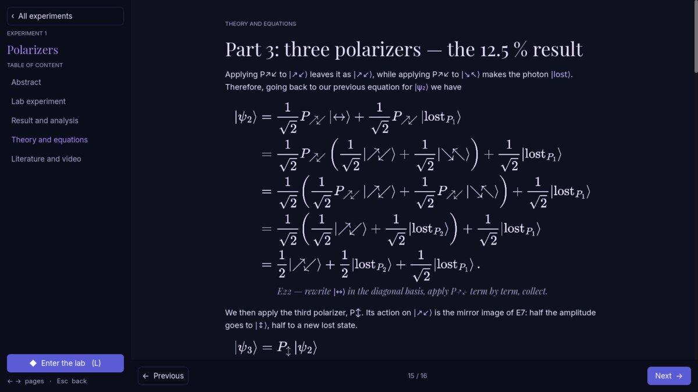
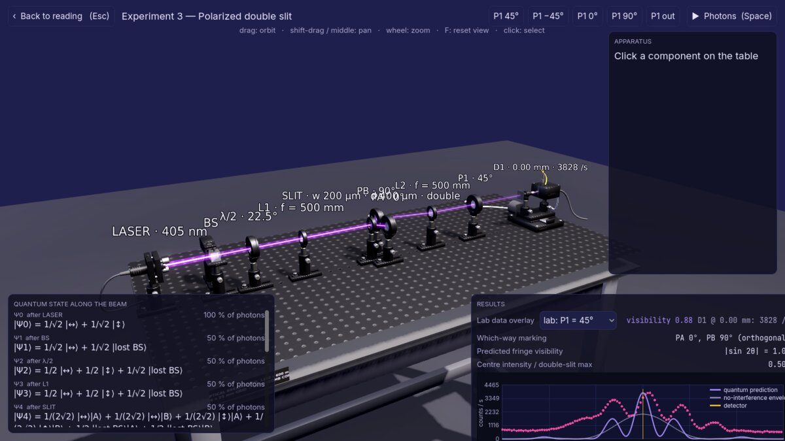
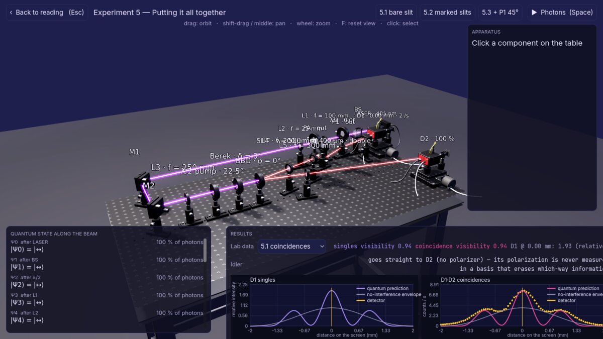

# Testing Reality — the interactive laboratory

An educational desktop app that rebuilds the quantum-optics course at
[testing-reality.webflow.io](https://testing-reality.webflow.io) as a narrated, explorable
3D laboratory: from the three-polarizer paradox to the delayed-choice quantum eraser.

Every chapter of the site is a chapter of the app: story pages that teach the maths just
before it is needed (vectors, Pythagoras, cosines as projections, complex phases, "and"
lists), followed by a laboratory you can walk around in, with real-looking apparatus you can
adjust — polarizer angles, slit widths, pump polarization, idler polarizer basis — and a
quantum engine computing exactly what the real detectors would count, next to the lab's own
published data.

```
quagmire-engine/   Quagmire Engine (Rust core + Godot SDK) — reusable, to be split off
app/               the Godot 4.7 project (Testing Reality)
blender/           headless Blender scripts that build the apparatus models (→ app/assets/models)
tools/             mathgen (TeX → SVG/PNG), build and export scripts, lab-data summariser
docs/              plan, design docs, page content specs transcribed from the site, assets
```

## Screenshots

| | |
|---|---|
|  |  |
|  |  |
|  |  |
|  | |

## Running

Requirements: Godot 4.7.2, Rust (stable), Node 22, Blender 4.3 (only to rebuild models).

```bash
tools/build-sdk.sh                      # builds the Quagmire GDExtension into app/addons/quagmire
cd tools/mathgen && npm install && npm run build:png   # renders every chapter's equations
godot --path app                        # run the app
```

Headless checks:

```bash
cd quagmire-engine && cargo test                            # engine golden tests (the site's numbers)
godot --headless --path app -s tests/smoke_quagmire.gd      # engine through GDScript
xvfb-run -a godot --path app -- --go=lab:exp1 --shot=/tmp/lab.png   # screenshot a lab
```

## How the physics works

The Quagmire Engine models each experiment as a small register of labelled quantum
properties (polarization `|↔⟩, |↕⟩`, path `|A⟩, |B⟩`, idler polarization…) with a sparse
state vector. Polarizers send blocked amplitude into `|lost⟩` states, exactly like the site's
derivations, so the HUD can show `|Ψ2⟩ = 1/2 |↗↙⟩ + 1/2 |lost P2⟩ + 1/√2 |lost P1⟩` after
every element. Detector patterns come from
`I(y) = Σ_env |Σ_path c · φ_path(y)|²`, which gives diffraction, which-way marking, erasure and
coincidence post-selection with no special cases. See `quagmire-engine/README.md`.

## Credits

Course content, experiments and data: Testing Reality (© 2018–2026, Creative Commons).
Interactive edition: built with Godot, Rust (godot-rust), Blender and MathJax.
