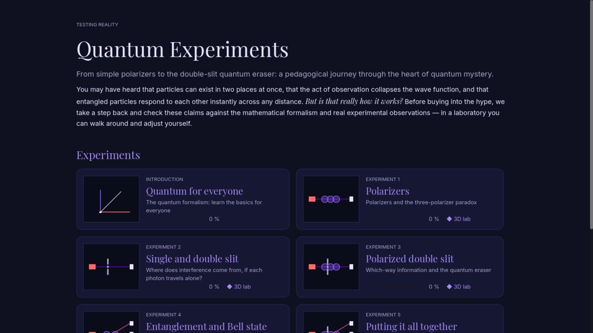
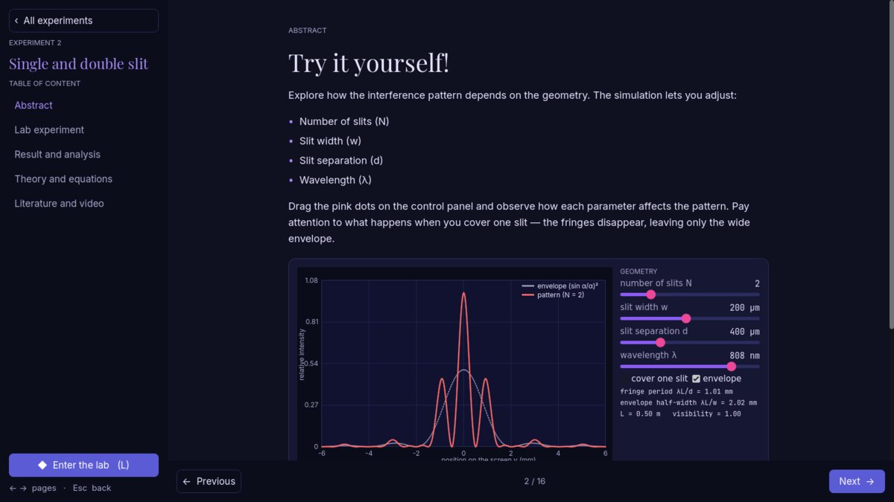
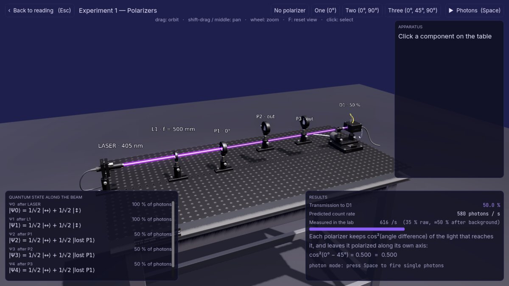
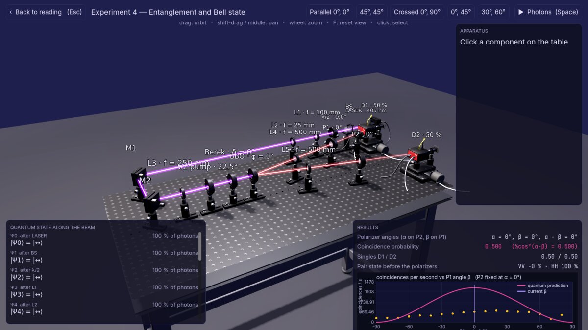

# Testing Reality — the interactive laboratory

An educational desktop app that rebuilds the quantum-optics course at
[testing-reality.webflow.io](https://testing-reality.webflow.io) as a narrated, explorable
3D laboratory: from the three-polarizer paradox to the delayed-choice quantum eraser.

Every chapter of the site is a chapter of the app: story pages that teach the maths just
before it is needed (vectors, Pythagoras, cosines as projections, complex phases, "and"
lists), followed by a laboratory you can walk around in, with real-looking apparatus you can
adjust — polarizer angles, slit widths, pump polarization, idler polarizer basis — and a
quantum engine computing exactly what the real detectors would count, next to the lab's own
published data.

```
quagmire-engine/   Quagmire Engine (Rust core + Godot SDK) — reusable, to be split off
app/               the Godot 4.7 project (Testing Reality)
blender/           headless Blender scripts that build the apparatus models (→ app/assets/models)
tools/             mathgen (TeX → SVG/PNG), build and export scripts, lab-data summariser
docs/              plan, design docs, page content specs transcribed from the site, assets
```

## Screenshots

| | |
|---|---|
|  |  |
|  |  |
|  |  |
|  | |

## Running

Requirements: Godot 4.7.2, Rust (stable), Node 22, Blender 4.3 (only to rebuild models).

```bash
godot --path app                        # run the app (the extension binaries are committed)
tools/build-sdk.sh                      # rebuild the Quagmire GDExtension (needs Rust)
cd tools/mathgen && npm install && npm run build:png   # re-render the chapter equations
```

The tool scripts find Godot on `PATH`, in `~/.local/bin`, or as the Flatpak
(`org.godotengine.Godot`); set `GODOT=/path/to/godot` to override.

### Desktop builds

```bash
tools/export.sh        # builds/linux/testing-reality.x86_64 and builds/windows/testing-reality.exe
```

Needs the Godot 4.7.2 export templates (Editor → Manage Export Templates). The Windows
build also needs `rustup target add x86_64-pc-windows-gnu` and the `mingw-w64` package; it is
skipped otherwise.

The Quagmire GDExtension binaries (Linux, Windows) are committed in `app/addons/quagmire/bin`,
so a fresh clone opens in Godot without a Rust toolchain; `tools/build-sdk.sh` rebuilds them.

## Testing

```bash
tools/test.sh            # everything below, headless and under xvfb (logs in builds/test-logs)
tools/test.sh --quick    # skip the xvfb / GL pass
```

| Step | What it checks |
|---|---|
| `cargo test` in `quagmire-engine/` | 26 golden tests: the site's numbers (12.5 %, fringe visibilities, Bell correlations…) |
| `godot --headless --import` | every asset imports, the extension registers |
| `tests/smoke_quagmire.gd`, `tests/smoke_widgets.gd` | engine API through GDScript; every widget with its documented parameters |
| `tests/run_all.gd` | loads all scripts, instantiates all scenes, then drives the real app: hub cards and settings, every chapter page (table of contents, keys, widgets, equations, figures, progress), every lab (presets, each apparatus parameter through the inspector, measured-data overlays, photons, picking, camera, Esc/back) |
| screenshots | `--go=<route> --shot=<png>` for the hub, chapter pages and all seven labs |

Any `SCRIPT ERROR` / `ERROR` / `WARNING` line printed by Godot fails the run.

## In the laboratory

Every lab is the real bench: click any instrument to open its controls (polarizer angle and
in/out of the beam, slit width and separation, cover a slit, detector position and slit, pump
wave plate, Berek phase, idler wall, D2 cable), drag to orbit, shift-drag to pan, wheel to
zoom. Then run it:

- **Shutter and power** on the laser: close it and the beam, the rates and the counts stop.
- **Counting** (top right): Run starts a real-time acquisition. Every channel (D1, D2, D1·D2
  coincidences) accumulates Poisson counts at the predicted rate, shown with ± √N; the
  coincidence-counter box on the entangled benches shows the same digits.
- **Scan D1** (slit labs): the motorised stage steps the detector across the pattern, counting
  at each position, and draws your points (green) over the prediction and the lab's data.
- **Photons** (Space): single photons, or pump photons that split into pairs at the crystal,
  fly down the beam and are absorbed or detected according to a joint draw from the state.
- **Stages**: click a line of the state panel to follow the beam only that far; the camera
  frames the element and everything downstream is dimmed.

Settings offers three 3D quality presets. *Low* (no shadows or glow, 75 % render scale,
no MSAA) is meant for integrated graphics; *Medium* is the default. The heaviest bench
(Experiment 7) draws about 110 k triangles in roughly 750 draw calls, which any
mid-range laptop GPU of the last decade handles at 60 fps; see
`docs/design/performance.md`. What is on the table and why is documented in
`docs/design/bench-accuracy.md`.

## How the physics works

The Quagmire Engine models each experiment as a small register of labelled quantum
properties (polarization `|↔⟩, |↕⟩`, path `|A⟩, |B⟩`, idler polarization…) with a sparse
state vector. Polarizers send blocked amplitude into `|lost⟩` states, exactly like the site's
derivations, so the HUD can show `|Ψ2⟩ = 1/2 |↗↙⟩ + 1/2 |lost P2⟩ + 1/√2 |lost P1⟩` after
every element. Detector patterns come from
`I(y) = Σ_env |Σ_path c · φ_path(y)|²`, which gives diffraction, which-way marking, erasure and
coincidence post-selection with no special cases. See `quagmire-engine/README.md`.

## Credits

Course content, experiments and data: Testing Reality (© 2018–2026, Creative Commons).
Interactive edition: built with Godot, Rust (godot-rust), Blender and MathJax.
